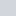

# Plotting Multiple Points & Input Modes

You can plot up to **9 points (Point A through Point I)** simultaneously on the same psychrometric chart—ideal for comparing outdoor air, return air, mixed air, coil outlet, and room conditions together.

## 1. Add, Edit, and Delete Points

- **Add a new point**: Tap an empty area on the chart to open the entry panel for the next unused slot (A → B → C …). After saving a point, tap **Add Next Point** to keep adding. When all 9 slots are filled, *"All 9 points are already used"* is shown.
- **Edit an existing point**: Tap near a plotted marker on the chart to open **Edit Point** for that letter.
- **Delete a point**: Tap the trash icon in the edit panel header and confirm **Delete**.

## 2. Input Methods

### Free Input (Any Two Properties)
Choose any two properties from the six options in the dropdowns:

- **Temperature**
- **Relative Humidity**
- **Dew Point**
- **Humidity Ratio**
- **Enthalpy**
- **Wet Bulb Temperature**

!!! note "Forbidden Pair"
    **Dew Point** and **Humidity Ratio** both represent the same vapor pressure, so they cannot be paired together (selecting one automatically excludes the other). Switching a dropdown while both fields contain numbers automatically converts the field to match the current air state.

### `(From graph)` Interactive Picking
Check **(From graph)** under either input field to lock manual typing for that field and **read values directly by tapping or dragging on the chart**.  
The unchecked field stays fixed while you visually slide along the chart.

- When the panel is floating, checking **(From graph)** makes the panel semi-transparent so you can clearly see the chart underneath.

### `Extended Feature` (Process Mode)
When at least one point is already plotted, tap **Extended Feature** at the top of the panel to plot a new point along a constant-property line from an existing point (tap **Free Input** to switch back).

1. Select the **property to hold constant** and the **reference point**.
2. The locked value appears in a read-only box and a red dashed isoline is drawn on the chart.
3. Enter the changing property or check **(From graph)** to slide the preview marker directly along that red dashed line.

This makes it easy to plot constant-humidity-ratio heating, constant-enthalpy humidification, or constant-RH changes accurately.

## 3. Name, Color, and Chart Display Controls

- **Name & Plot Color**: On the next step after **OK**, enter an optional **name** and pick one of 8 colors (**Green**, **Red**, **Orange**, **Yellow**, **Light Blue**, **Blue**, **Violet**, **Black**).
- **Chart Lines**: Open **Menu** → **Chart Lines** to toggle **Relative Humidity Lines**, **Enthalpy Lines**, **Specific Volume Lines**, and **Wet Bulb Temperature Lines**.
- **Zoom / Fit All**: Use the **Zoom** / **Fit All** button in the top bar to switch between fit-to-screen and 7:5 zoomed view. In zoomed mode, use two-finger pinch to zoom and the bottom/right scrollbars to pan—axis and isoline labels stay visible along the viewport edges.
- **Panel Position**: Tap the position toggle icon in the panel header to switch between floating (draggable) and docked (bottom in portrait, right in landscape).

!!! info "Hiding Individual Points"
    On the main chart itself, all non-empty points (A–I) are drawn; to remove a point from the chart, delete it from its edit panel. If you want to hide or show specific points in the data table, use Display Settings (gear icon) inside [Compare & Heat Load](compare.md).
