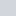

# Save & Load

You can store up to **9 sets of plotted points (Slot 1–9)** locally in the app and reload them anytime.

## Save Your Points

1. Open **Menu** → **Save**.
2. Select a destination under **Saved Data** (**Slot 1**–**Slot 9**).
3. Enter a **file name**.
   - If you leave the name blank, the current date and time (e.g., `2026-11-19 15:30`) is automatically assigned so saving never fails.
4. Tap **Save**.

!!! note "Rewarded Ad on Free Android Plan"
    On the free Android plan, tapping **Save** prompts *"Watch an ad to save?"*. Tap **Watch Ad & Save** and complete the rewarded video ad to save the slot.  
    Pro users (Monthly, Yearly, Lifetime, or 3-Day Pass) and the docked Web desktop menu panel save immediately without ads.

## Load or Delete Saved Slots

1. Open **Menu** → **Load** (or tap **Load** from the dialog that appears when tapping an empty chart).
2. Browse **Saved Data** (populated slots show the count of saved points, such as `3 / 9`).
3. Tap a slot to load its points onto the chart.
4. To clear a slot permanently, tap the trash icon on its row and confirm **Delete**.

## Start Fresh (`New`)

Open **Menu** → **New** to clear all current points from the chart. If unsaved points exist, a confirmation warning appears first.

!!! tip "Unit-Safe Storage"
    Saved points are stored internally in Metric units (`°C`, `kg/kg(DA)`, `kJ/kg`). You can freely switch between Metric and Imperial (US) units before or after loading without losing precision.
