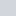

# Units & Language

Open **Menu** → **Settings** (or the gear icon in the docked Web desktop menu panel) to change your unit system, language, account, and subscription settings.

## 1. Switching Unit Systems

Under **Unit System**, you can switch anytime between:

- **Metric** (SI)
- **Imperial (US)**

| Quantity | Metric | Imperial (US) |
| --- | --- | --- |
| Temperature / Dew Point / Wet Bulb | `°C` | `°F` |
| Humidity Ratio | `kg/kg(DA)` | `gr/lb(DA)` (`1 lb = 7000 grains`) |
| Enthalpy | `kJ/kg` (0°C datum) | `Btu/lb` (ASHRAE 0°F datum) |
| Specific Volume | `m³/kg(DA)` | `ft³/lb(DA)` |
| Airflow (HVAC Simulation) | `m³/h` | `CFM` (`ft³/min`) |
| Cooling Capacity (Peak / CSV) | `kW` | `RT` (US Refrigeration Ton) |
| Heating / Reheat Capacity (Peak / CSV) | `kW` | `Btu/h` |
| Electricity / Energy (HVAC Simulation) | `kWh` | `kBtu` |
| Humidify / Dehumidify / Steam Mass | `kg` | `lb` |
| Gas Volume (when Heating Source = Gas) | `m³` | `ft³` |

!!! note "Safe Unit Switching"
    Plotted and saved points are always stored internally in Metric units. Switching unit systems while entering values or after saving automatically converts values without rounding drift.

!!! info "Enthalpy Datum Difference"
    SI defines 0 kJ/kg at 0°C dry air, whereas ASHRAE IP defines 0 Btu/lb at 0°F dry air. State enthalpy values apply this datum offset, while differences and tolerances cancel the offset and scale directly (`1 Btu/lb = 2.326 kJ/kg`).

## 2. Switching Languages

Under **Language**, select **System default** or pick manually from **over 70 supported languages** (`en`, `ja`, etc.).

## 3. Other Items in Settings

- **Subscription**: Shows your current plan (**Free plan**, active subscription, or **3-Day Pass** expiration), **Go Professional**, **Manage Subscription**, **Restore Purchases**, **Log in to Web Version (Paid)**, and **Share Web Version Link**.
- **Account**: **Sign in with Google** to unlock your Android Pro entitlement on the Web version.
- **Contact Us**, **Privacy Policy**, **Privacy Options** (in applicable regions), and **Data Sources** attributions (NASA POWER / GeoNames).
