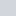

# Getting Started (5-Minute Tutorial)

When you first open the app, you will see an empty psychrometric chart with no points plotted yet.  
In this tutorial, you will plot **25°C and 50% relative humidity**, read the calculated values, and save your work.

## Step 1: Open the Point Entry Panel

1. **Tap anywhere** on the psychrometric chart.
2. When no points exist yet, a dialog asks *"Create new points or load saved data"*.
3. Tap **New**. The entry panel (**Enter Point Values**) opens on screen.

!!! tip "Move or Dock the Panel"
    Drag the top handle to move the floating panel freely, or tap the position toggle icon in the panel header to dock it to the bottom (portrait) or right side (landscape).

## Step 2: Enter Temperature & Humidity and Plot

1. Make sure the first dropdown is set to **Temperature** and enter `25`.
2. Make sure the second dropdown is set to **Relative Humidity** and enter `50`.
   - You can also choose Dew Point, Humidity Ratio, Enthalpy, or Wet Bulb Temperature (see [Plotting Points](features/plotting.md) for all combinations).
3. Tap **OK**.
4. Enter an optional **name** (e.g., `Room`) and choose a **Color** (from 8 colors), then tap **OK**.
5. **Point A** appears on the chart.
   - Tap **Add Next Point** to plot another point, or **Done** to finish.

## Step 3: Read the Calculated Values

To see all thermodynamic properties for your plotted point, open **Menu** → **Compare** from the top bar.

For 25°C and 50% RH (at standard atmospheric pressure 1013.25 hPa), you will see approximately:

| Property | Approximate Value | Unit |
| --- | --- | --- |
| Temperature | 25.0 | °C |
| Relative Humidity | 50.0 | % |
| Dew Point | 13.9 | °C |
| Humidity Ratio | 0.010 | kg/kg(DA) |
| Enthalpy | 50.3 | kJ/kg |
| Wet Bulb Temperature | 17.8 | °C |
| Specific Volume | 0.858 | m³/kg(DA) |

See [Reading the Chart](reading-the-chart.md) to learn what each property means.

!!! tip "Edit or Delete a Point"
    Tap near an existing point marker on the chart to reopen its edit panel, change values or color, or delete it via the trash icon.

## Step 4: Save Your Data

1. Open **Menu** → **Save**.
2. Choose a save destination (**Slot 1** through **Slot 9**) under **Saved Data**.
3. Enter a **file name** (e.g., `Summer Case`). If left blank, the current date and time is used automatically.
4. Tap **Save**.
   - On the free Android plan, a confirmation dialog (*"Watch an ad to save?"*) appears. Tap **Watch Ad & Save** and watch the rewarded video ad to complete saving. (Pro users save immediately without ads.)

You can reload saved slots anytime from **Menu** → **Load**.
