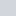

# 空調模擬（AHU プロセス設計）

**空調模擬**（画面タイトル：**空調構成**）は、1つの開始状態（外気や混合空気など）から5つの空調機要素を通過したときの空気状態の変化を逐次計算し、空気線図上にリアルタイムで可視化する Pro 機能です。

メニューの **「空調模擬」** から開けます（※年間の統計計算を行う「空調シミュレーション」とは独立した単発のプロセス設計ツールです）。

## 1. 開始点を動かしてリアルタイムに追従させる

画面上の大きな丸（**開始点**、初期値 20℃・50%RH）は、**空気線図上をタップまたはドラッグ**することで自在に移動できます。  
開始点を動かすと、すべての有効な機器の出口状態と最終出口が即座に再計算され、チャート上の折れ線がリアルタイムに追従します。

## 2. 機器構成（5つの機器と ON/OFF）

パネル上部のチップから各機器の **チェックボックスで有効／無効（ON/OFF）** を切り替えられます（無効にした機器は空気がそのまま素通りします）。チップをタップすると、その機器の詳細設定が開きます。

1. **プレヒーター**（赤色マーカー）
   - 加湿前の予熱を行います（絶対湿度一定でエンタルピーを増加させます）。
   - **加熱熱源**: `蒸気` / `ガス` / `電気` から選択します。
   - `蒸気` を選んだときのみ **最大加熱能力**（既定 `40 kJ/kg`）の上限が適用されます（`ガス`・`電気` は容量上限なし）。
2. **蒸気加湿**（黄色マーカー）
   - プレヒーターで熱量が不足している場合などに、蒸気を吹き込んで加湿します。
   - **蒸気の比エンタルピー**（既定 `2706 kJ/kg`、200 kPa 飽和蒸気相当）で過程線の傾きが決まります。
3. **ワッシャー**（水色マーカー）
   - 比エンタルピー一定の断熱加湿を行います。
   - **到達相対湿度**（既定 `90%`）を上限として、目標絶対湿度に向かって加湿します。
4. **冷水コイル**（露点：紫色マーカー ／ 出口：青色マーカー）
   - 容量上限なしの理想的な冷水コイルとして計算します。
   - **除湿が必要な場合（2点動作）**: ①まず絶対湿度一定の顕熱冷却で飽和曲線（相対湿度 100%＝露点）まで冷やし、②そこから飽和曲線に沿って目標絶対湿度まで冷却除湿します。
   - **除湿が不要な場合**: 後のリヒーターの加熱だけでセットポイントの許容範囲内に到達できるときは無駄な除湿を行わず、必要な場合のみ顕熱冷却します。
5. **リヒーター**（オレンジ色マーカー）
   - 冷却・除湿後の空気を絶対湿度一定で再熱します。
   - **加熱熱源**: `蒸気` / `ガス` / `電気` から選択します。
   - セットポイントに許容幅が設定されている場合は、許容範囲に収まる**最も低い温度**まで加熱して過剰な再熱を抑えます。

## 3. セットポイント（目標値と許容幅）

パネルの **「セットポイント」** チップを選ぶと、目標条件を設定できます。

- **目標値**: 目標の **温度**（既定 `24℃`）と **相対湿度**（既定 `50%`）を入力します。
- **許容幅**: 温度（`±`）と相対湿度（`±`）のチェックボックスを有効にして許容幅を設定できます。
  - チャート上に緑色の許容範囲枠が描かれます。
  - 許容幅が設定されている場合、目標点はその許容範囲の対角線上で **開始点のエンタルピーに最も近い点** へ動的に追従します。

## 4. 到達状態の確認と「比較」（各機器の変化量）

パネル下部の **「到達状態」** では、開始点・各機器出口（冷水コイル除湿時は露点を含む）・目標の温度と相対湿度がチャート上のマーカーと同じ色付きで一覧表示されます。

さらに詳細な数値変化や機器負荷を見たい場合は、画面右上の **メニュー** → **「比較」** をタップしてください（**空調構成の比較** ダイアログ）。

- **ポイント一覧**: 開始点から目標までの全ポイントについて、温度・相対湿度・露点温度・絶対湿度・エンタルピー・湿球温度・比容積を一覧表示します。
- **各機器の変化量**: 隣接する2点間の差分（各機器での変化量 ΔT, ΔW, Δh など）を並べて確認できます。
- **単位換算（稲妻アイコン）**: **「風量を加味する」** にチェックを入れて `処理空気量 (m³/min)` を入力すると、各機器の **水分量** (`kg/h`) や **電力** (`kW`) ／ **熱量** (`kcal/h`) をすぐに概算できます。

!!! note "別の AHU 設定同士を並べて比較する機能について"
    空調模擬画面の「比較」は、現在構成している1つの AHU チェーン内における **開始点〜各機器出口〜目標の状態値および各機器の変化量** を一覧比較する機能です。2つの異なる AHU 設定ファイルを保存して左右に並べる機能はありません。
